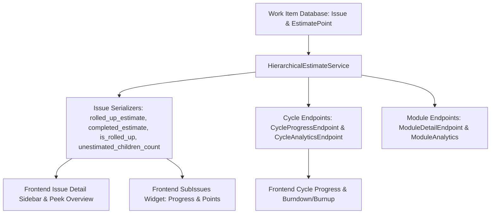

# Plane Hierarchical Estimates — Implementation Plan

**Document Version:** 1.0  
**Target:** Plane Production / Local Development Stack  

---

## 1. Architectural Strategy

To ensure 100% mathematical consistency without duplicating logic across Frontend, Django Views, Cycle Analytics, and Background Workers, all hierarchical estimate operations will be governed by a **Single Source of Truth Service**:
`apps/api/plane/app/services/estimate_service.py` (`HierarchicalEstimateService`).



---

## 2. Backend Implementation Details

### Step 2.1: Unified Calculation Service
File: `apps/api/plane/app/services/estimate_service.py`
Methods:
1. `calculate_issue_rollup(issue_or_id)`:
   - Recursively queries active descendants of the given issue.
   - Determines if the issue is a parent or leaf.
   - Computes:
     - `effective_estimate`: Total numeric estimate points.
     - `completed_estimate`: Sum of completed leaf points (`state__group="completed"`).
     - `remaining_estimate`: Sum of incomplete, uncancelled points.
     - `progress_percentage`: `(completed / total) * 100` if total > 0 else 0.
     - `unestimated_children_count`: Number of leaf descendants without an estimate point.
     - `is_rolled_up`: `True` if item has child issues, `False` if leaf.
2. `calculate_scope_aggregates(scope_issues_qs)`:
   - Identifies in-scope leaf items (items in `scope_issues_qs` whose `id` is not present in `scope_issues_qs.values('parent_id')`).
   - Aggregates points strictly over these leaves, preventing any double-counting between parents and children.
   - Supports grouped statistics by `state__group`, `assignees`, and `labels`.

### Step 2.2: Serializers Extension
Files:
- `apps/api/plane/app/serializers/issue.py`
  - Enhance `IssueListDetailSerializer`, `WorkItemSerializer`, and `IssueDetailSerializer` to include:
    - `rolled_up_estimate`: float | null
    - `completed_estimate`: float | null
    - `remaining_estimate`: float | null
    - `is_rolled_up`: boolean
    - `unestimated_children_count`: integer
  - When an issue has children (`sub_issues_count > 0` or children exist), calculate these attributes via the service.

### Step 2.3: Cycle & Analytics Endpoints Integration
Files:
- `apps/api/plane/app/views/cycle/base.py`
  - In `CycleProgressEndpoint`: Replace the naive `Sum("value_as_float")` with `HierarchicalEstimateService.calculate_scope_aggregates(issues_qs)`.
  - In `CycleAnalyticsEndpoint`: Filter assignee and label distributions to in-scope leaves to eliminate double-counting.

---

## 3. Frontend Implementation Details

### Step 3.1: TypeScript Type Definitions
File: `packages/types/src/issues/issue.ts`
- Extend `TBaseIssue` and `TIssue` with:
  ```typescript
  rolled_up_estimate?: number | null;
  completed_estimate?: number | null;
  remaining_estimate?: number | null;
  is_rolled_up?: boolean;
  unestimated_children_count?: number;
  ```

### Step 3.2: MobX Store Updates
File: `apps/web/store/issue/issue-details/issue.store.ts`
- Ensure `addIssueToStore` preserves the new hierarchical estimate attributes.

### Step 3.3: UI Components
1. **Sidebar Property & Peek Overview (`apps/web/components/issues/issue-detail/sidebar.tsx` & `peek-overview/properties.tsx`):**
   - When `issue.is_rolled_up` is true (or `sub_issues_count > 0`):
     - Display the rolled-up estimate badge (e.g., `8 Points (Auto-calculated)`).
     - Display a compact progress bar: `3 / 8 Points (37.5%)`.
     - Display an unestimated warning if `unestimated_children_count > 0`.
     - Display an informational tooltip explaining that the manual estimate is safely preserved in DB and child estimates are rolled up.
   - When `is_rolled_up` is false (leaf item):
     - Display the standard interactive `EstimateSelect` dropdown.
2. **Sub-issues Widget (`apps/web/components/issues/issue-detail-widgets/sub-issues/title.tsx`):**
   - Display estimate points progress alongside item count if estimates are enabled.

---

## 4. Verification & Testing Plan

Automated test script verifying the 9 required cases:
- Case 1: Independent Task (5 Points -> Effective = 5)
- Case 2: Task with Subtasks (3 + 5 -> Effective = 8)
- Case 3: Epic with Tasks (Task 1 rollup 8 + Task 2 manual 3 -> Effective = 11)
- Case 4: Parent with preserved manual estimate (8 manual + children 3 & 5 -> Effective = 8, no double count of 16)
- Case 5: Completion Progress (3 Done + 5 In Progress -> 37.5% progress)
- Case 6: Update Subtask estimate (child updated from 5 to 8 -> Parent becomes 11, Epic becomes 14)
- Case 7: Unestimated child warning (1 unestimated child detected and flagged)
- Case 8: Cross-cycle isolation (Effort not duplicated across Sprint A and Sprint B)
- Case 9: Multi-project and permissions safety

Full reporting in `docs/estimates/ESTIMATES_TEST_REPORT.md`.
